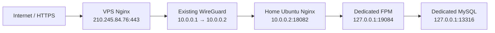

# KENFINLY 2.0 — network and public domain

Verified 2026-11-18 (Asia/Saigon). The Mac development host remains independent.



## DNS and proxy boundaries

- Public `my.kenfinly.com` A resolves to VPS **210.245.84.76**; no AAAA was observed. DNS was already correct and was not changed.
- VPS access: `ssh -p 15973 getkenka@getkenka.com`. From that host: `ssh sysuser@10.0.0.2`. Existing SSH host trust was enforced; no host-key verification bypass was used.
- VPS `wg0` is `10.0.0.1/24`, with the existing home peer allowed `10.0.0.2/32`. Home `wg0` is `10.0.0.2/24`, with its existing VPS peer route `10.0.0.0/24`. Peers, keys, default routes and WireGuard configuration were preserved.
- Actual VPS virtual host: `/etc/nginx/sites-available/my.kenfinly.com.conf`, enabled by the existing symlink. Suggested `/var/www/getkenka/my.kenfinly.com.conf` did not exist.
- Home virtual host: `/etc/nginx/sites-available/my.kenfinly.com.conf`, listening only at `10.0.0.2:18082` and `127.0.0.1:18082`, with source ACL for VPS/loopback and exact hostname enforcement.
- The only new Ubuntu firewall allowance is TCP 18082 **on wg0, source 10.0.0.1, destination 10.0.0.2**. Other rules/default policies are preserved.

VPS sends fixed Host/X-Forwarded-Host `my.kenfinly.com`, scheme `https`, port `443`, and **replaces** X-Forwarded-For with the actual client address. It discards incoming Forwarded and forwarding-prefix overrides. Home keeps the actual immediate peer (`10.0.0.1`) and passes the edge headers to FPM. Existing framework configuration uses `TRUSTED_PROXIES=10.0.0.1`; no wildcard trust or PHP code change was needed.

Correlated request IDs in the dedicated edge/home logs proved the actual path through both Nginx hosts and FPM. An intentionally spoofed forwarding header did not alter the application's login rate-limiter client identity. Private evidence contains the correlation and counter results without publishing client addresses.

## Public HTTPS and renewal

A matching existing Let's Encrypt certificate was found and reused. The initial wrong-name HTTPS response came from the missing target TLS virtual host. No forced production reissuance or private-key copying was needed.

| Item | Actual value |
| --- | --- |
| Certificate name/SAN | `my.kenfinly.com` |
| Issuer | Let's Encrypt YR1 |
| Validity observed | 2026-11-18 02:14:48 UTC to 2027-02-16 02:14:47 UTC |
| Certificate/key paths | `/etc/letsencrypt/live/my.kenfinly.com/{fullchain.pem,privkey.pem}` on VPS |
| Certbot used | Existing native 1.21.0; current lineage uses the existing Nginx authenticator/installer |
| Renewal | Existing `certbot.timer` and snap renewal timer preserved; no shared timer replacement |
| Owned deploy hook | `/etc/letsencrypt/renewal-hooks/deploy/kenfinly2-nginx`, acts only for this lineage and checks Nginx before reload |

The temporary ACME HTTP webroot `/var/lib/kenfinly-acme` is retained, but the reused lineage's actual renewal authenticator remains **nginx**. Do not describe the no-op `certonly --webroot` call as a new issuance or a persisted plugin change.

Successful selected-lineage renewal simulation:

```bash
sudo certbot renew --cert-name my.kenfinly.com --dry-run --non-interactive --no-random-sleep-on-renew
```

The first dry-run SSH invocation timed out; the retry disabled renewal's randomized delay and recorded server-side output. The final simulation succeeded. Only the named certificate was tested. HTTP redirects to HTTPS; HSTS is limited to this hostname (no `includeSubDomains`, preserving alpha development independence). Normal curl and Chromium verification use trusted public TLS; no insecure exceptions are part of this setup.

## Scoped SMTP path

Postfix on the VPS gained only a marked listener at **10.0.0.1:2525**. It accepts only authenticated WireGuard peer address `10.0.0.2/32` and envelope sender `no-reply@my.kenfinly.com`. Sender map: `/etc/postfix/kenfinly2-senders`. Existing public mail services, global relay policy and existing DKIM configuration remain unchanged.

This internal SMTP hop is encrypted/authenticated by WireGuard, like the internal HTTP hop; it does not negotiate a second TLS layer or disable certificate verification. Non-peer clients and unapproved senders were rejected with 554. A dedicated non-login `kenfinly-verify` account receives synthetic mail in `/var/mail/kenfinly-verify` at `kenfinly-verify@localhost.localdomain`. Actual registration mail arrived and its signed HTTPS link was accepted with verification still enabled.

External mailbox delivery and sender-domain SPF/DKIM alignment remain unverified. Existing getkenka DNS uses Zoho and kenfinly DNS uses registrar mail forwarding; no mail DNS record or unrelated SMTP credential was changed/reused. Local VPS delivery is not evidence of Gmail/other external deliverability.

## Preservation and network rollback

Both hosts validate `nginx -t` before explicit reload. Original configurations are backed up under `/var/backups/kenfinly-2/20261118-before/`. Code rollback keeps this network/TLS path intact.

Full decommission/config rollback must affect only the owned host files, exact UFW allowance, conditional renewal hook and service drop-ins. Restore the target file only after reviewing its backup, validate configuration and gracefully reload; preserve all unrelated sites, peers, routes, certificates and shared CA state. Do not remove database/storage data or automatically restore a DB as a network rollback.

Home Nginx and the VPS Postfix instance have owned startup-order drop-ins for their already enabled `wg-quick@wg0` services. Reboot persistence was configured without rebooting either shared host. Existing broadly bound legacy MySQL/Jenkins/tunnel ports predate this task and were not hardened under this scope; the **new** database/FPM endpoints remain loopback-only.
